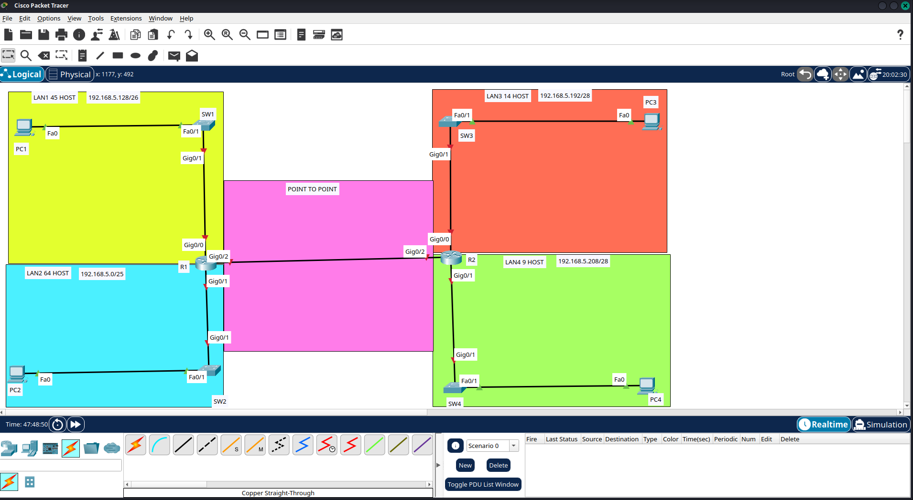
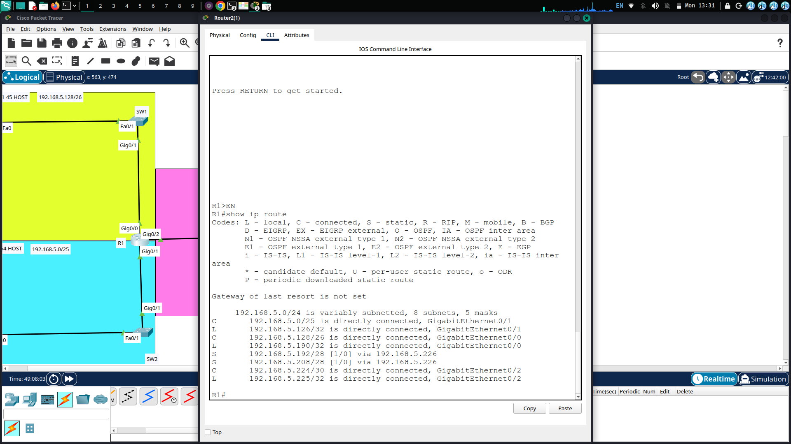
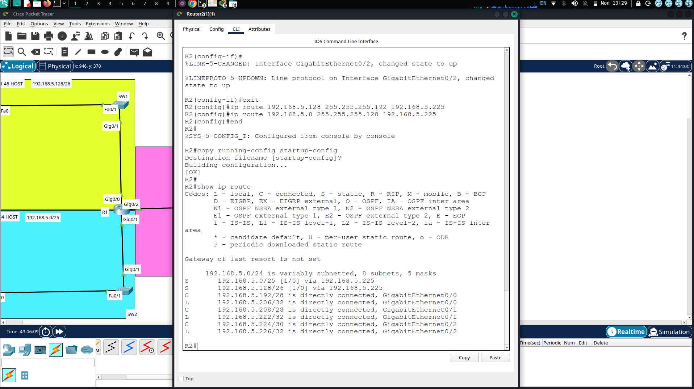
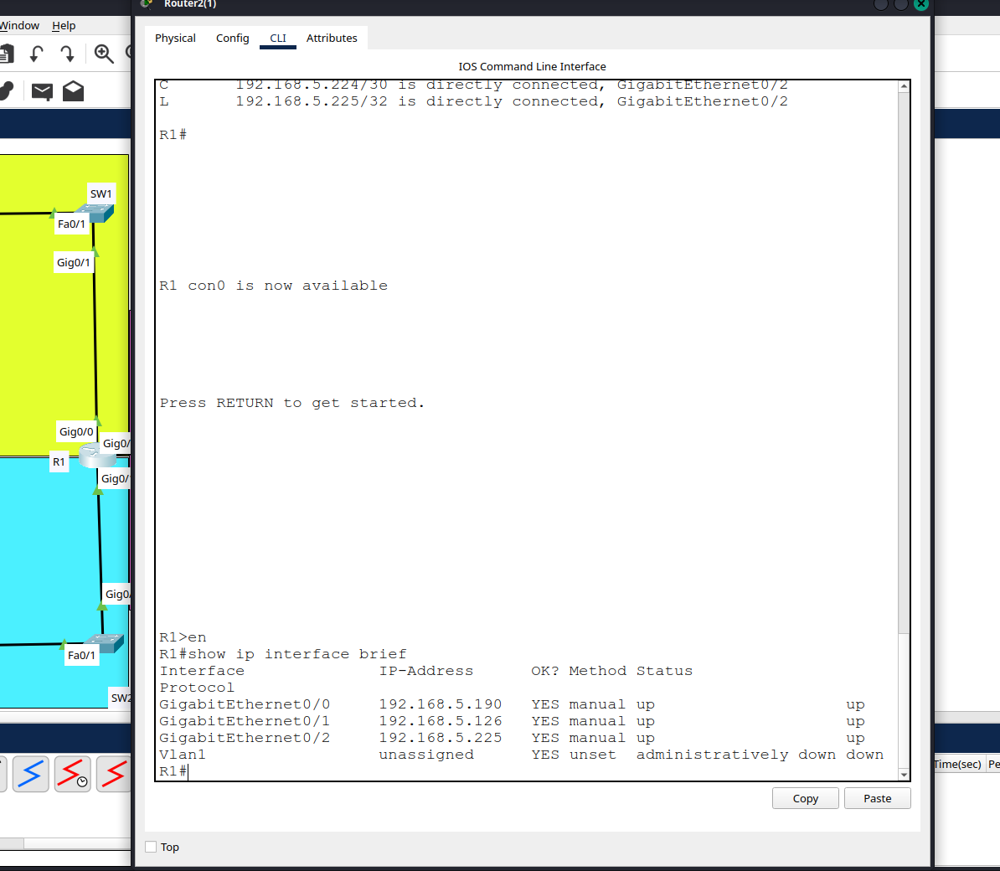
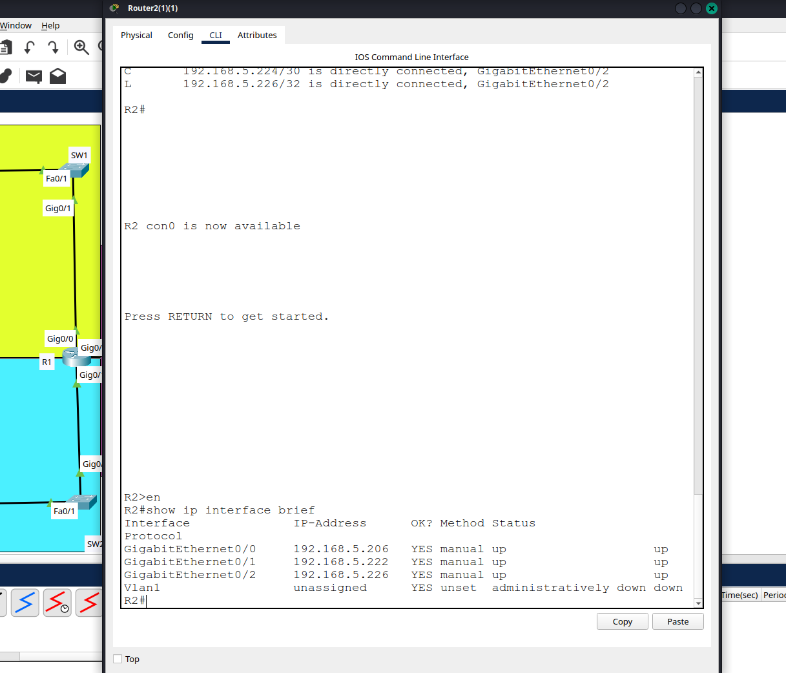
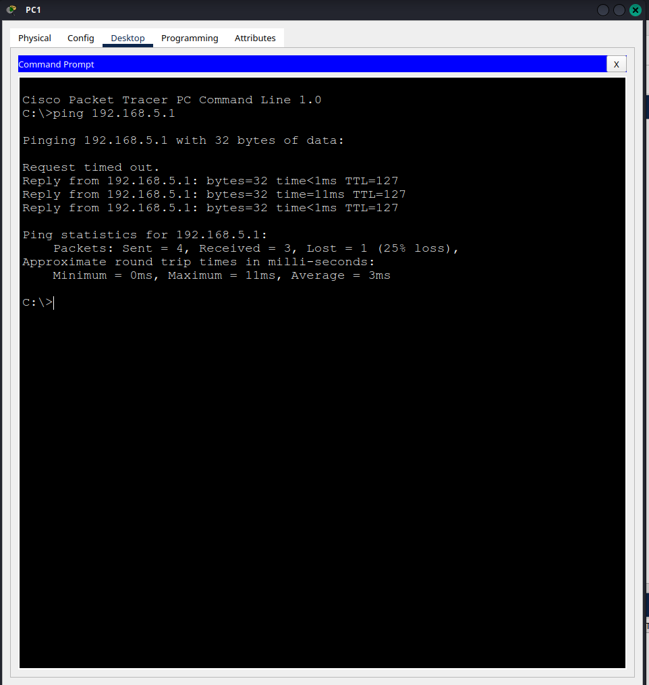
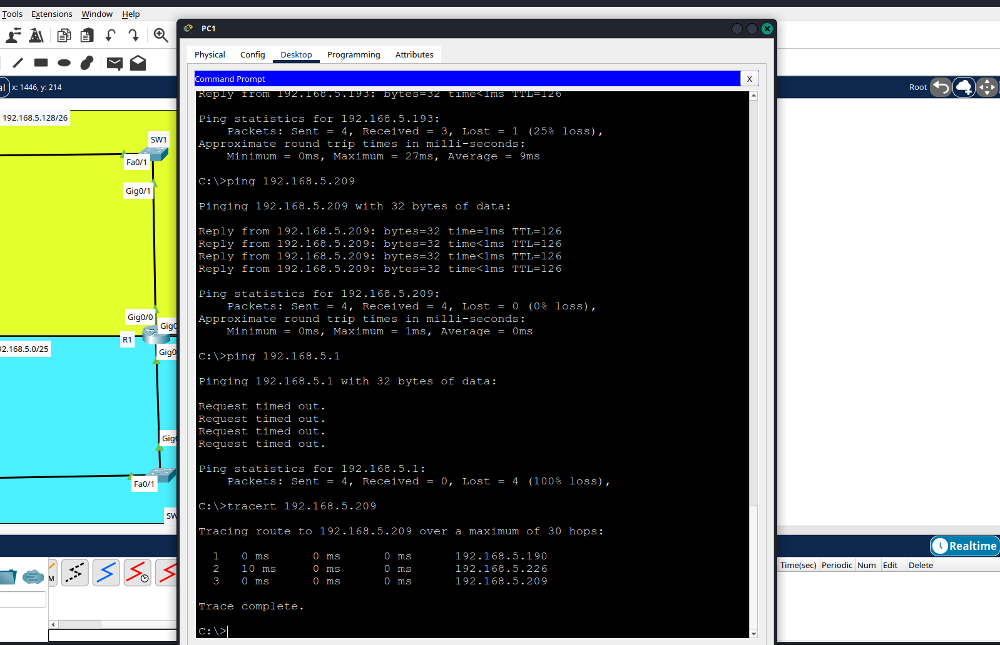
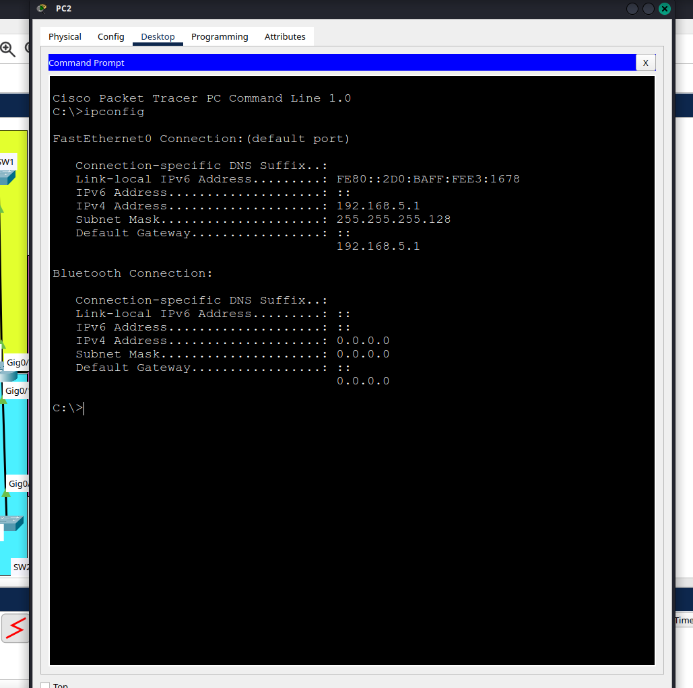

# Lab 01: Static Routing with VLSM

Tool: Cisco Packet Tracer | Date: 9 November 2026

## Objective

Subnet 192.168.5.0/24 using VLSM so that each LAN gets only the addresses it needs, connect two routers with a point-to-point link, and configure static routes so that every PC can reach every other PC.

Requirements:
- LAN1: 45 hosts, LAN2: 64 hosts, LAN3: 14 hosts, LAN4: 9 hosts, plus the R1-R2 link
- The first usable address on each LAN goes to the PC
- The last usable address on each LAN goes to the router interface
- Static routes only (no routing protocol)

## Topology



## VLSM design

I allocated the largest network first so the blocks do not overlap.

| Network | Hosts needed | Block | Mask | Usable range | Broadcast |
|---|---|---|---|---|---|
| LAN2 | 64 | 192.168.5.0/25 | 255.255.255.128 | .1 - .126 | .127 |
| LAN1 | 45 | 192.168.5.128/26 | 255.255.255.192 | .129 - .190 | .191 |
| LAN3 | 14 | 192.168.5.192/28 | 255.255.255.240 | .193 - .206 | .207 |
| LAN4 | 9 | 192.168.5.208/28 | 255.255.255.240 | .209 - .222 | .223 |
| R1-R2 link | 2 | 192.168.5.224/30 | 255.255.255.252 | .225 - .226 | .227 |

Why these sizes:
- LAN2 needs a /25: 64 hosts plus the network and broadcast addresses is 66, which does not fit in a /26 (64 addresses).
- LAN1 needs a /26 (62 usable) for 45 hosts.
- LAN3 and LAN4 use a /28 (14 usable). A /29 has only 6 usable addresses, which is not enough for 9 hosts.
- The point-to-point link uses a /30, which has exactly 2 usable addresses.
- 192.168.5.228 to 192.168.5.255 is still unallocated and available for future growth.

Assumption: LAN3 has 14 usable addresses in a /28, and I treated the 14 hosts as the total number of devices needing addresses on that LAN. If the router interface had to be counted on top of 14 hosts, LAN3 would need a /27.

## Addressing table

| Device | Interface | IP address | Subnet mask | Default gateway |
|---|---|---|---|---|
| R1 | Gig0/0 (LAN1) | 192.168.5.190 | 255.255.255.192 | |
| R1 | Gig0/1 (LAN2) | 192.168.5.126 | 255.255.255.128 | |
| R1 | Gig0/2 (link to R2) | 192.168.5.225 | 255.255.255.252 | |
| R2 | Gig0/0 (LAN3) | 192.168.5.206 | 255.255.255.240 | |
| R2 | Gig0/1 (LAN4) | 192.168.5.222 | 255.255.255.240 | |
| R2 | Gig0/2 (link to R1) | 192.168.5.226 | 255.255.255.252 | |
| PC1 | Fa0 | 192.168.5.129 | 255.255.255.192 | 192.168.5.190 |
| PC2 | Fa0 | 192.168.5.1 | 255.255.255.128 | 192.168.5.126 |
| PC3 | Fa0 | 192.168.5.193 | 255.255.255.240 | 192.168.5.206 |
| PC4 | Fa0 | 192.168.5.209 | 255.255.255.240 | 192.168.5.222 |

## Static routes

Each router only knows its own connected networks, so each one needs routes to the networks behind the other router.

R1:
```
ip route 192.168.5.192 255.255.255.240 192.168.5.226
ip route 192.168.5.208 255.255.255.240 192.168.5.226
```

R2:
```
ip route 192.168.5.128 255.255.255.192 192.168.5.225
ip route 192.168.5.0 255.255.255.128 192.168.5.225
```

Full configuration commands are in [configs.txt](configs.txt).

## Verification

### Routing tables

Both routers show connected (C), local (L) and static (S) routes. "Gateway of last resort is not set" is expected because no default route was configured in this lab.

R1:



R2:



### Interfaces

All interfaces are up/up. Vlan1 is the router's default management interface and is not used in this lab.

R1:



R2:



### Connectivity

All four PCs can ping each other. Results from PC1 (the first ping can be lost while ARP resolves):

| Destination | TTL | Meaning |
|---|---|---|
| 192.168.5.190 (R1) | 255 | directly connected router |
| 192.168.5.1 (PC2) | 127 | one router (R1) crossed |
| 192.168.5.226 (R2) | 254 | one router (R1) crossed |
| 192.168.5.193 (PC3) | 126 | two routers crossed |
| 192.168.5.209 (PC4) | 126 | two routers crossed |

`tracert 192.168.5.209` from PC1 goes through 192.168.5.190 (R1), then 192.168.5.226 (R2), then reaches 192.168.5.209 (PC4).



## Troubleshooting

### Problem 1: PC1 could reach PC3 and PC4 but not PC2

Symptom: pings from PC1 to 192.168.5.1 returned "Request timed out" (100% loss), while PC3 and PC4 replied normally.



Investigation: the routing tables of R1 and R2 were correct and `tracert` to PC4 succeeded, so routing was not the problem and the fault had to be inside LAN2. The result was a timeout rather than "Destination host unreachable", which suggested the request arrived but the reply could not return.

Root cause: `ipconfig` on PC2 showed its default gateway as 192.168.5.1 (its own address) instead of 192.168.5.126 (R1 Gig0/1). PC2 received the request but sent its reply to itself.

Fix: I set the default gateway on PC2 to 192.168.5.126. PC1 could then ping PC2 with 0% loss (TTL 127).



### Problem 2: "Destination host unreachable" from the gateway

While testing I mistyped a target as 92.168.5.226 (missing the leading 1). R1 (192.168.5.190) replied "Destination host unreachable" because it has no route to 92.168.5.0. A reply of this type from the gateway means "I have no route to that network", not that the target host is down.

## What I learned

- VLSM saves address space: five networks fit inside one /24 with room left over.
- A static route needs a matching route in the opposite direction, or replies are lost.
- `show ip route` shows what a router knows, but only ping and tracert prove that traffic flows. TTL shows how many routers a packet crossed.
- Check host settings (gateway and mask) before blaming the routers.

## Where static routes are used in real networks

- Default route from a small office or branch towards its ISP
- Branch office with one link to head office
- Backup link using a floating static route with a higher administrative distance, for example a 4G link that only takes over when the main fibre fails
- Stub networks with a single exit
- Forcing traffic through a firewall or inspection device

Limits: static routes do not adapt to topology changes and become hard to maintain in large networks, which is why larger networks use OSPF or BGP.

## Files

- `static-routing-vlsm.pkt`: Packet Tracer file
- `configs.txt`: configuration commands for R1 and R2
- `Screenshots/`: evidence
