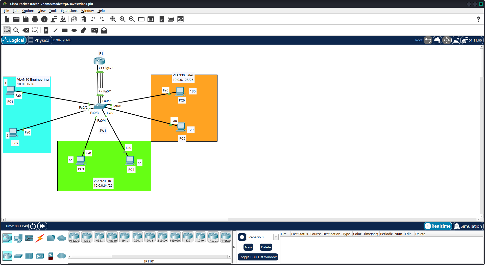

# VLAN Segmentation Lab — Cisco Packet Tracer

## Goal

The goal of this lab is to segment a small office network into three VLANs — Engineering, HR, and Sales — on a single switch (SW1), and to route traffic between them using a router (R1) with one physical interface per VLAN. Each VLAN is its own /26 subnet, and R1 acts as the default gateway for all three. This design deliberately avoids router-on-a-stick and trunking: every link between R1 and SW1 is a plain access port carrying exactly one VLAN. The lab ends with ping tests that verify connectivity within a VLAN and between VLANs.

## Topology

R1 is connected to SW1 with three cables — one per VLAN. Six PCs hang off SW1: two per VLAN.

## Addressing table

| Device | VLAN | IP Address | Default Gateway |
|---|---|---|---|
| PC1 | 10 (Engineering) | 10.0.0.1 /26 | 10.0.0.62 |
| PC2 | 10 (Engineering) | 10.0.0.2 /26 | 10.0.0.62 |
| PC3 | 20 (HR) | 10.0.0.65 /26 | 10.0.0.126 |
| PC4 | 20 (HR) | 10.0.0.66 /26 | 10.0.0.126 |
| PC5 | 30 (Sales) | 10.0.0.129 /26 | 10.0.0.190 |
| PC6 | 30 (Sales) | 10.0.0.130 /26 | 10.0.0.190 |
| R1 Gig0/0 | 10 (Engineering) | 10.0.0.62 /26 | — (is the gateway) |
| R1 Gig0/1 | 20 (HR) | 10.0.0.126 /26 | — (is the gateway) |
| R1 Gig0/2 | 30 (Sales) | 10.0.0.190 /26 | — (is the gateway) |

Subnets: VLAN10 = 10.0.0.0/26 (broadcast 10.0.0.63), VLAN20 = 10.0.0.64/26 (broadcast 10.0.0.127), VLAN30 = 10.0.0.128/26 (broadcast 10.0.0.191).

## Port mapping (SW1)

R1 links were verified with `show cdp neighbors` and the VLAN of each port with `show vlan brief`; PC-to-port mapping comes from the topology.

| SW1 port | Connected to | VLAN | Role |
|---|---|---|---|
| Gig0/1 | R1 Gig0/0 | 10 | Uplink (Engineering) |
| Gig0/2 | R1 Gig0/1 | 20 | Uplink (HR) |
| Fa0/1 | R1 Gig0/2 | 30 | Uplink (Sales) |
| Fa0/2 | PC1 | 10 | Access |
| Fa0/3 | PC2 | 10 | Access |
| Fa0/4 | PC3 | 20 | Access |
| Fa0/5 | PC4 | 20 | Access |
| Fa0/6 | PC5 | 30 | Access |
| Fa0/7 | PC6 | 30 | Access |

Note: R1's third link plugs into a FastEthernet port (Fa0/1), which is why the uplink mapping above is asymmetric.

> VLAN names note: the names ENGINEERING, HR, and SALES live in SW1's VLAN database (`show vlan brief`), not in the running-config. That is why `configs/SW1-running-config.txt` contains no `vlan 10` / `name ...` lines — this is normal Cisco behavior, not an omission.

## What I did

1. Built the topology in Packet Tracer: R1 + SW1, six PCs, and three cables between R1 and SW1 (one per VLAN, no trunking).
2. Assigned every PC a static IP and the correct default gateway from the addressing table above.
3. On SW1, created VLANs 10, 20, and 30 and named them ENGINEERING, HR, and SALES; placed each access port into its VLAN with `switchport mode access` (no dynamic/trunk ports).
4. On R1, configured Gig0/0, Gig0/1, and Gig0/2 as the default gateways for VLANs 10, 20, and 30 respectively. Shut down the Vlan1 SVI on both devices.
5. Ran ping tests: PC-to-PC inside the same VLAN, and PC-to-PC across VLANs through R1.

## Test results

One screenshot per step of the verification:

- `images/01-topology.png` — the finished topology in Packet Tracer.
- `images/02-show-vlan-brief-sw1.png` — `show vlan brief` on SW1, listing VLANs 10/20/30 with names ENGINEERING, HR, SALES.
- `images/03-show-ip-interface-brief-r1.png` — `show ip interface brief` on R1, showing the three gateway interfaces.
- `images/04-ipconfig-pc1.png` — `ipconfig` on PC1, showing the static IP 10.0.0.1/26 with gateway 10.0.0.62.
- `images/05-ping-same-vlan.png` — ping test between two PCs in the same VLAN (VLAN10).
- `images/06-ping-between-vlans.png` — ping test between PCs in different VLANs. Ping from PC1 (10.0.0.1) to PC3 (10.0.0.65) succeeds. PC1 sees that 10.0.0.65 is outside its /26 subnet, so it sends the packet to its default gateway (R1, 10.0.0.62). R1 has all three subnets as directly connected networks, so it forwards the packet out of the VLAN20 interface (Gig0/1) with no routing protocol needed.

## Lessons learned

- Each /26 block holds 64 addresses, so the gateway (last usable address) is .62, .126 and .190, and the broadcast addresses are .63, .127 and .191. Working these out by hand made subnetting much clearer.
- Every cable between R1 and SW1 must sit in the VLAN that matches the gateway address on the router port it connects to. I verified the mapping with `show cdp neighbors` and `show vlan brief`, and found that my third link uses SW1 Fa0/1 instead of a gigabit port.
- VLAN names are stored in the VLAN database (`show vlan brief`), not in the running-config, so the config file alone does not show them. Ports I did not use (Fa0/8 to Fa0/24) are still in VLAN 1 and not shut down, which an attacker could plug into.

## Security considerations

### VLAN hopping

**Switch spoofing** — an attacker connected to a switch port can speak Dynamic Trunking Protocol (DTP) and trick the port into becoming a trunk, gaining access to every VLAN.

**Double tagging** — an attacker sitting on the native VLAN sends frames carrying two 802.1Q tags. The first trunk switch strips the outer (native) tag and forwards the frame with the inner tag still intact, delivering it into the target VLAN.

**Background concept (not a result verified in this lab):** VLANs are separate broadcast domains, so broadcast traffic is normally confined to its own VLAN and inter-VLAN traffic must pass through a router or L3 device. This lab has not captured broadcast behavior, so this statement is included here only as background, not as a verified outcome of the lab.

**Mitigations:**

- Disable DTP on all ports (`switchport nonegotiate`) so a port can never negotiate itself into a trunk.
- Set every port explicitly to access mode (`switchport mode access`) — as done in this lab.
- Change the native VLAN away from the default VLAN 1 (use a dedicated, unused VLAN for the native VLAN) so double-tagging attacks have no working native VLAN to ride on.
- Shut down unused ports (or park them in an unused VLAN) so there are no free ports for an attacker to plug into.

This lab already applies part of this hardening: all ports are explicit access ports, no trunks exist, and the Vlan1 SVI is shut down on both R1 and SW1.

One further hardening note from the config review: both devices have `line vty 0 4` with `login` but no password configured. That is fine for an offline Packet Tracer lab, but a production device should have strong passwords or AAA in place.

## Still to add

- A broadcast simulation screenshot (planned as `images/07-...`) will be added later to demonstrate broadcast behavior. Until then, this README makes no claim about broadcast isolation as a tested result.
